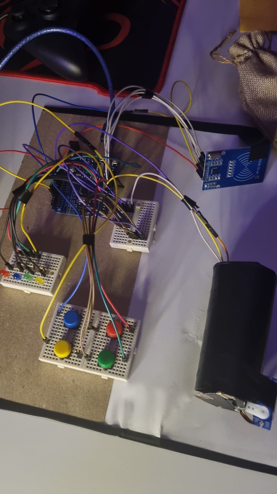
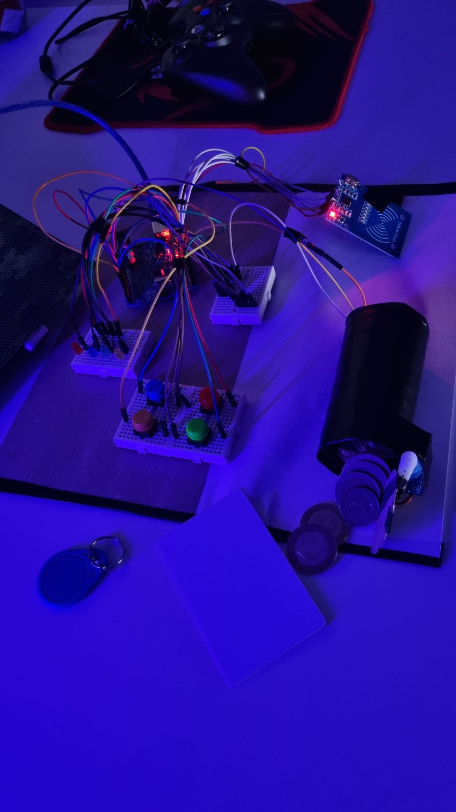

# THE GOLDEN VAULT 🔐

## About the Project

THE GOLDEN VAULT is a project I built using Arduino Uno. The idea was to create a small vault that opens only after completing two steps: scanning the correct RFID card and solving a color sequence puzzle.

I wanted to build something practical that combines electronics, programming, and hardware components in one project.

## How It Works

The project works in three steps:

1. First, the user scans an RFID card.
2. If the card is correct, the LEDs show a color sequence that the user must repeat using the buttons.
3. If the sequence is correct, the servo motor rotates and opens the vault.

The color sequence is: **Red → Blue → Green → Yellow**.

## Components Used

* Arduino Uno R3
* RC522 RFID reader and card
* 4 LEDs
* 4 push buttons
* Servo motor
* Buzzer
* Breadboard and jumper wires
* A box used as the vault

## What I Learned

While working on this project, I practiced using RFID with Arduino, reading button inputs, controlling LEDs, and working with a servo motor.

I also learned how to combine different components into one working system and how to test each part before integrating everything together.

## Project Status

The project is completed and working successfully. I also recorded a video showing the final result and shared it on LinkedIn.

## Future Improvements

There are still some things I could improve in the future, such as the physical design of the vault and adding more puzzles to make the project more challenging.

## Future Improvements

* Improve the vault's physical enclosure.
* Add additional authentication methods.
* Expand the puzzle system with more challenge levels.

## 👨‍💻 Author

Computer Engineering Student

GitHub: [HadofaX](https://github.com/HadofaX)

## Project Gallery
Here are some photos of the final project.

